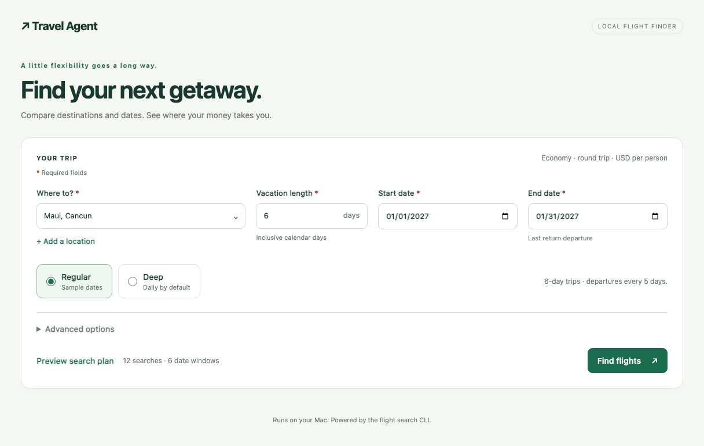
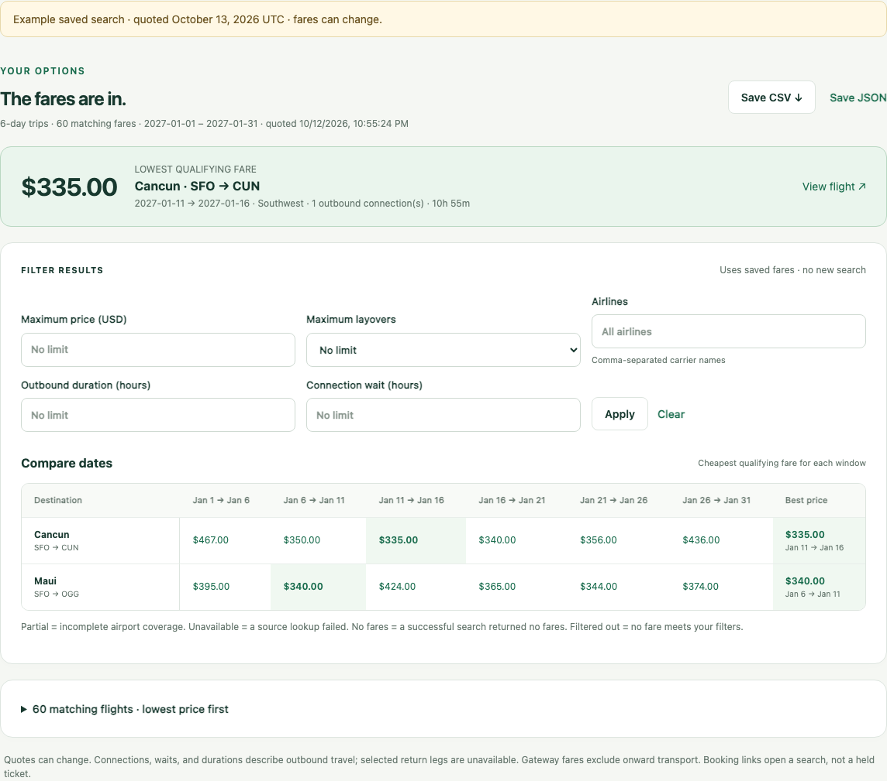
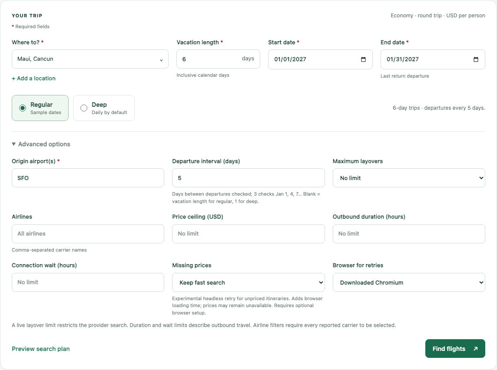

# Travel Agent Deal Tracker

A free, login-free research tool and Codex skill for comparing cash flights, public award-deal reports, card and transfer offers, Airbnb result cards, and hotel search links. It does not buy, sell, hold, or book travel.

The flight-only CLI defaults to **SFO**, with 50 selectable destinations. The combined tracker defaults to SFO/SJC. Both accept custom IATA airports.

Use the lightweight local browser app to choose destinations, compare flexible dates, filter saved fares, and export a CSV. The same search and filtering commands work directly in the CLI, without an agent or a frontend build.

## Setup and Requirements

Install these first:

- **Python 3.14**, the tested runtime, with `pip` and `venv`: [Python downloads](https://www.python.org/downloads/).
- **Git** to clone and update the project: [Git downloads](https://git-scm.com/downloads/).
- An internet connection to install packages and fetch live fares. Filtering saved results works offline.

For the **flight CLI and browser app only**, use [requirements-flights.txt](requirements-flights.txt); it installs `fast-flights` and its dependencies. For award feeds, hotels, and BnBs as well, use [requirements.txt](requirements.txt). Playwright is a dependency of the combined tracker, but flight searches do not require it or browser-binary downloads. The CLI and app run without travel-account credentials or an OpenAI API key; Codex is optional for using the agent skill.

The optional **slower browser retry** needs [requirements-browser.txt](requirements-browser.txt):

```bash
.venv/bin/python -m pip install -r requirements-browser.txt
.venv/bin/python -m playwright install chromium
```

Alternatively, select installed Google Chrome and omit the Chromium download. Both choices launch a separate **headless** browser with a fresh context; they do not connect to your open browser, use its profile, or require computer-control access. Current [Playwright system requirements](https://playwright.dev/python/docs/intro#system-requirements) list macOS 14+. Older Macs can continue using the default fast search without this option.

An isolated **visible native Chrome diagnostic** recovered Singapore prices that the headless path missed, including a five-day January 2027 trip. It is not integrated into the app. See [the experiment and commands](docs/native-chrome-price-investigation.md) for its optional Node.js/Chrome setup, verification, and limits. Normal app setup remains as above.

On macOS/Linux:

```bash
git clone https://github.com/sabcodes/Travel-Agent-Skills.git
cd Travel-Agent-Skills
python3.14 -m venv .venv
.venv/bin/python -m pip install -r requirements-flights.txt
```

If you already have the repository, run the environment and package-install commands from its root. On Windows, create the environment with `py -3.14 -m venv .venv` and replace `.venv/bin/python` with `.venv\Scripts\python.exe` in the commands.

Verify setup with a network-free search preview:

```bash
.venv/bin/python flight_tools.py --help
.venv/bin/python flight_tools.py search --dest cancun,maui \
  --start-date 2027-01-01 --end-date 2027-01-31 --dry-run --format table
```

Continue with the browser app or flight CLI below, or see [Load the Skill in Codex](#load-the-skill-in-codex) for agent setup. Install `requirements.txt` instead when using the combined tracker.

## App preview

Choose locations, vacation length, and dates, then preview the exact search plan. This example samples six-day trips every five days.



Compare the lowest qualifying fares across dates, filter by price, airline, layovers, and travel time, then export CSV or JSON. The image uses previously captured public quotes; it is an example, not current availability.



<details>
<summary>See advanced options</summary>

Control departure spacing, origin airports, airlines, layovers, and optional price/time limits. The slower headless retry is experimental and has not yet recovered the Singapore prices shown during testing.



</details>

See [screenshot notes](docs/screenshots/README.md) for capture details and reuse.

## Local browser app

After setup, double-click **Launch Travel Agent.command** in Finder, or run:

```bash
.venv/bin/python flight_ui.py
```

It opens `http://127.0.0.1:8765` in your browser. Keep the terminal open while using the app; press Control-C there to stop it. If the launcher lost its executable permission, run `chmod +x "Launch Travel Agent.command"`. If the port is occupied, run `.venv/bin/python flight_ui.py --port 0` to choose an available port. `--no-browser` starts the server without opening a tab.

The app uses Python's standard library and plain HTML/CSS/JavaScript, with no Node installation or frontend build. Use a current Safari, Chrome, Firefox, or Edge browser. The [Python universal2 installer](https://docs.python.org/3.14/using/mac.html) supports Intel and Apple Silicon; the inspected Python 3.14 and flight dependency versions have Mac wheels for both architectures. The known requirements are macOS 10.15+ on Intel and macOS 11+ on Apple Silicon. Install a fresh virtual environment on each Mac rather than copying `.venv`. The app has been tested on Apple Silicon; Intel hardware has not been tested. Dependency updates may change supported OS versions.

1. Choose locations in the searchable multi-select dropdown. **Add a location** accepts a name, one or more arrival IATA airport codes, and an optional gateway note.
2. Enter inclusive vacation days and start/end dates. Six days means Jan 1–6. The end date is the last return **departure**, not final arrival.
3. Choose **Regular** or **Deep**. In the UI, regular defaults to the vacation length as the departure interval; deep defaults to daily departures. **Advanced options** exposes an optional **Departure interval** for either mode, origin airports, airlines, maximum layovers, and price/duration/wait limits. An interval of 3 checks departures on Jan 1, 4, 7, etc. Deep with an interval above 1 samples dates rather than checking every day. Vacation length and departure interval are different; additional trip lengths remain a CLI option.
4. Fields marked **\*** are required. Empty submissions show a message and highlight the missing inputs. **Preview search plan** shows the exact number of lookups without fetching fares. **Find flights** immediately brings the progress panel above the form into view, then shows completed lookups plus an approximate ETA after the first lookup. Failures count as completed attempts; provider delays and retries affect ETA. **Stop search** cancels the process.
5. Compare the date matrix and lowest qualifying fare, expand matching itineraries, and apply offline filters. **Save CSV** downloads the visible filtered matrix, including empty/error statuses and best-fare details. **Save JSON** retains raw candidates for later CLI filtering. Filtering does not refresh availability.

Added locations persist in `~/Library/Application Support/Travel Agent/locations.json` on macOS; `--data-dir PATH` changes that folder. Additions belong to this local app and do not edit the checked-in presets. To use them directly in the CLI, add the same records to a full destination pool as described below; the local additions file is not a merged preset pool.

The app serves only on `127.0.0.1`, runs one live search at a time, and executes fixed CLI commands without a shell. Refreshing the page reconnects to the active search or current results and restores the submitted search settings. Results live in temporary files until the app stops or another search replaces them; export before stopping. There is no searchable history. Search/filter/export data remains local except for the live provider requests and booking links you open. The agreed scope and verification criteria are in [docs/local-flight-ui.md](docs/local-flight-ui.md).

Editing vacation length or other search settings marks the existing table as **previous results**. Click **Find flights** to fetch fares for the edited settings. The summary labels the actual trip length searched, so a saved five-day table cannot be mistaken for a new thirty-day search. A blank regular departure interval follows the vacation length; an explicit interval remains an independent sampling choice.

Under **Advanced options → Missing prices**, choose **Retry in browser (slower)** and a browser engine. It is off by default. The CLI first runs the fast search, then retries only route/date combinations containing eligible unpriced itineraries. It resolves airline names from provider metadata, preserves the live layover limit, and inspects Best, View more flights, and Cheapest using fixed Playwright selectors. It reads complete framed shopping responses, including additional priced itineraries for missing carriers; an exact DOM match can also fill a quote on an existing itinerary. Regular/deep date sampling stays the same, and normal price/airline/duration/wait filters apply to recovered fares.

Browser loading adds time. UI waits share a 45-second budget per retry; failures and unresolved prices are recorded in `browser_attempts` and `source_warnings`. Progress labels the browser phase, and recovered rows say **browser quote** with `price_source` and `price_checked_at` in JSON. This is a best-effort fallback: Google may return errors, challenges, or unpriced results, and its UI/data format can change. The tool does not bypass challenges or infer missing fares. Recent live headless checks did not reproduce the screenshot's priced Singapore itineraries; use the saved statuses rather than treating browser retries as complete airline coverage.

The [Singapore price investigation](docs/singapore-price-investigation.md) found numeric quotes in a supplied Cheapest-view HAR that the existing decoder can read. Fresh headless searches still received empty Singapore prices with matching search filters; selecting both flights reached Google's “Price hidden because it might be incorrect” message. The cause of the differing responses remains under investigation. Captured amounts are historical evidence and are not added to live rankings.

### Browser regression test

The optional [ui_browser_test.py](ui_browser_test.py) uses Playwright to add **Dhaka, Bangladesh (DAC)** through the UI and run a five-day regular January 2027 search from SFO, then change it to thirty days and verify the request/table use Jan 1–30. It also checks required fields, visible progress/ETA, a custom deep interval, airline filters, CSV/JSON downloads, and refresh recovery. It persists the added location and runs seven live lookups; it is separate from the offline unit suite. `--duration-change-only` reuses a completed five-day Dhaka search and runs only the one thirty-day lookup.

For this developer test only, install Playwright (`.venv/bin/python -m pip install playwright`). Use an installed Chrome browser with `--browser chrome`, or download Chromium with `.venv/bin/python -m playwright install chromium` and omit that option. The app itself does not require Playwright.

With the local app running:

```bash
.venv/bin/python ui_browser_test.py --live --browser chrome \
  --output-dir /tmp/flight-ui-dhaka-check
```

Add `--headed` to watch the test in a browser window. Screenshots, exports, and the structured test report go to the output folder; keep them outside commits.

## Flight-only CLI

Run these commands from the repository root. No agent is needed to search, filter, or generate a comparison matrix.

```bash
# View the destination pool (ids, names, airport alternatives, gateway notes)
.venv/bin/python flight_tools.py destinations

# Lite: one departure every five days, six inclusive calendar days per trip
.venv/bin/python flight_tools.py search --origin SFO --dest cancun,maui \
  --start-date 2027-01-01 --end-date 2027-01-31 --trip-lengths 6 \
  --output /tmp/january-lite.json --format table

# Preview all 50 destinations without making any requests
.venv/bin/python flight_tools.py search --dest all \
  --start-date 2027-01-01 --end-date 2027-01-31 --dry-run

# Use weekly departures instead; any positive spacing is supported
.venv/bin/python flight_tools.py search --dest cancun,maui \
  --start-date 2027-01-01 --end-date 2027-01-31 --date-step-days 7

# Deep: every departure day for each requested trip length; test two locations
.venv/bin/python flight_tools.py search --mode deep --dest cancun,maui \
  --start-date 2027-01-01 --end-date 2027-01-31 --trip-lengths 6 \
  --output /tmp/january-deep.json --format table

# Filter a saved snapshot without fetching fares again
.venv/bin/python flight_tools.py filter --input /tmp/january-deep.json \
  --max-price 500 --max-stops 1 --max-duration-hours 12 --max-layover-hours 4 \
  --output /tmp/january-filtered.json --format table

# Opt-in headless retry; one exact 32-day window, no agent required
.venv/bin/python flight_tools.py search --origin SFO --dest DAC \
  --start-date 2027-01-14 --end-date 2027-02-14 --trip-lengths 32 \
  --airlines "Singapore Airlines" --browser-missing --browser-engine chromium \
  --output /tmp/dhaka-browser.json --format table
```

`--dest` accepts `all`, one destination, comma-separated names/ids, or IATA codes. Named Tokyo, Paris, and Tenerife searches compare both configured airports. Selecting `NRT` searches only Narita. `--origin` accepts one or more airports. The CLI defaults to a five-day step for lite and one day for deep; `--date-step-days` overrides either mode. Deep with its default interval checks every valid departure for each explicit length, not arbitrary return dates. An interval above 1 samples departures.

Use `--airlines "United,Lufthansa"` for a case-insensitive filter against exact reported carrier names in a live search or saved snapshot. For a mixed-carrier itinerary, **all reported carriers** must be in the selection; selecting only United excludes United/Lufthansa combinations. Blank means all airlines. This is a local filter that retains raw fares, so it can be cleared offline. The UI's airline fields provide suggestions from the saved raw results. Carrier labels do not certify the actual operating airline or selected return itinerary.

Trip lengths count **inclusive calendar days**: six days means Jan 1–6, not Jan 1–7. January lite windows are Jan 1–6, 6–11, 11–16, 16–21, 21–26, 26–31. The end date bounds the **return departure date**; the provider does not export the selected return itinerary or its final arrival date. Returns in February require an end date in February.

Prices are USD economy round-trip quotes for **one adult**. `--adults` remains an accommodation option in the combined tracker. Flight searches have **no implicit price ceiling**: configured destination thresholds and the old $2,000 discovery ceiling do not exclude fares. Use `--max-price` when a ceiling is wanted.

JSON is the default stdout format; progress goes to stderr. `--progress-json` adds one JSON progress event per completed lookup on stderr for the UI and other clients. `--output` always saves structured JSON even when stdout is a table. Snapshots contain the query, timestamp, all provider-returned candidates, status for every airport/date pair, a destination/window matrix, and deterministic minima. Fares rank by price, stops, outbound elapsed time, airline, and stable itinerary fields. This retains all results exposed by the provider; it does not guarantee exhaustive airline inventory.

The adapter reads both Google's best-flight and other-flight sections. Some itineraries are returned without numeric prices (including Singapore Airlines on tested SFO–Dhaka dates). These carriers and dates appear in `source_warnings` and the UI's **Itineraries without prices** notice; they are excluded from fare rankings. A missing quote does not mean the airline has no flights. Check Google Flights or the airline directly for a quote.

The offline filter reads `raw_flight_deals`, so local price/duration filters can be relaxed later. A `--max-stops` restriction used during live search narrows the provider query in both directions; offline filtering cannot recover fares omitted by that query. Saved connection counts, layover waits, and durations describe **outbound travel only**. All fares are retained; there is no top-two truncation.

Each matrix cell distinguishes `ok`, `partial`, `filtered_out`, `no_matching_fares`, `unavailable`, or `planned`. An unavailable source is never evidence of no flights. Any source error gives exit code 1 while still producing a snapshot; invalid input gives exit code 2. Successful and valid empty searches give exit code 0. For Bocas del Toro, an empty through-fare search does not rule out separate domestic tickets. Gateway notes flag unpriced onward travel.

### Add a location

Append a record to `flight_destinations.json`, or copy it and pass `--pool PATH`:

```json
{"id": "honolulu", "name": "Honolulu", "airports": ["HNL"]}
```

Use a unique id and uppercase three-letter airport codes. Optional `aliases` accept alternate names; optional `gateway_note` describes onward travel excluded from the fare. Multiple `airports` are searched independently and the matrix selects the cheapest qualifying airport. Validate the pool with `.venv/bin/python flight_tools.py destinations --pool PATH`. The flight pool is separate from the existing award/stay configuration.

### Compare flight backends

The app currently uses [`fast-flights`](https://github.com/AWeirdDev/flights) through our adapter. The optional [`fli` evaluation](docs/fli-backend-evaluation.md) compares it with a pinned `punitarani/fli` source version. Install that version in a **separate environment** with Python 3.10+, pip, Git, and an internet connection:

```bash
.venv/bin/python -m venv /tmp/travel-fli-eval
/tmp/travel-fli-eval/bin/python -m pip install -r requirements-fli-eval.txt
.venv/bin/python evaluate_flight_backends.py compare \
  --fli-python /tmp/travel-fli-eval/bin/python \
  --repeats 3 --output /tmp/flight-backend-evaluation.json
```

This runs four fixed SFO date pairs across Cancun and Dhaka, then expands return options for Cancun and Singapore Airlines on the two Dhaka screenshot date pairs. It saves each completed attempt, fare counts, missing-carrier notices, separate starting/selected-pair quotes, and median lookup times. The default performs 27 search operations; return expansion can fetch several pages per operation. `--top-n` defaults to 3; `--timeout` bounds each worker at 60 seconds. Exit code 1 means at least one provider/worker failure or timeout; unknown prices remain unknown. The `probe` subcommand accepts an explicit route and dates for individual checks once the fixed dates have passed.

The October 13, 2026 evaluation found no cheaper starting quotes and no recovered Singapore prices. `fli` provided return-itinerary detail, but its CLI used the outbound starting price for more expensive return combinations. Our evaluation keeps those price fields separate. See the report for evidence, limits, and the adoption decision; this command does not switch the app's provider or require Playwright.

## What It Searches

| Data lane | What the tool returns | Important limitation |
|---|---|---|
| Cash flights | Current cash fares, airlines, stops, layovers, durations, and Google Flights links | Prices can change before booking |
| Award deals | Attributed reports from public travel-news feeds | Reports are leads, not confirmed live award seats |
| Card and transfer offers | Public Chase, American Express, Capital One, and loyalty-program promotions | Relevance does not prove an itinerary is bookable with points |
| Airbnb | Up to three public result cards under the nightly budget | Totals may be estimates and can exclude final fees or taxes |
| Hotels | Date- and guest-aware Google Hotels links | Search handoff only; no hotel prices are retrieved |

Flight results are ranked deterministically by cash price, then fewer stops, shorter total journey, and airline name. Airbnb results are deduplicated by listing ID and ranked by nightly price, total price, and listing ID.

Provider failures appear in the JSON `source_errors` array instead of being reported as an empty search.

## Included Destination Presets

The flight-only CLI currently includes **50 destination presets** covering **53 airport codes**, defined in [flight_destinations.json](flight_destinations.json). Use a preset name or its id with `--dest`, comma-separated ids for a subset, or `--dest all` for the entire pool. Selecting an IATA code searches that airport only.

Presets with multiple airports compare them within one destination row. Gateway notes identify onward transport that is excluded from airfare.

| Location | CLI preset id | Arrival airport(s) | Gateway / onward travel note |
|---|---|---|---|
| Aguadilla | `aguadilla` | `BQN` | — |
| Anguilla | `anguilla` | `AXA` | — |
| Antigua | `antigua` | `ANU` | — |
| Aruba | `aruba` | `AUA` | — |
| Barbados | `barbados` | `BGI` | — |
| Belize City | `belize` | `BZE` | — |
| Bocas del Toro | `bocas_del_toro` | `BOC` | Through-fare search only; separate domestic tickets and PTY–PAC transfers are excluded. |
| Bonaire | `bonaire` | `BON` | — |
| Cancun | `cancun` | `CUN` | — |
| Cape Town | `cape_town` | `CPT` | — |
| Cape Verde (Sal) | `cape_verde_sal` | `SID` | — |
| Cartagena | `cartagena` | `CTG` | — |
| Curaçao | `curacao` | `CUR` | — |
| Dominica | `dominica` | `DOM` | — |
| Exuma | `exuma` | `GGT` | Great Exuma airfare; transport to other Exuma islands is excluded. |
| Grenada | `grenada` | `GND` | — |
| Guatemala Pacific Coast | `guatemala` | `GUA` | Ground transfer from Guatemala City to the Pacific coast is excluded. |
| Harbour Island | `harbour_island` | `ELH` | North Eleuthera airfare only; ground transfer and ferry are excluded. |
| Kauai | `kauai` | `LIH` | — |
| Key West | `key_west` | `EYW` | — |
| Kingston | `kingston` | `KIN` | — |
| Liberia, Costa Rica | `liberia_cr` | `LIR` | — |
| Lima | `lima` | `LIM` | — |
| Lisbon | `lisbon` | `LIS` | — |
| Malta | `malta` | `MLA` | — |
| Marrakech | `marrakech` | `RAK` | — |
| Maui | `maui` | `OGG` | — |
| Mexico City | `mexico_city` | `MEX` | — |
| Montego Bay | `montego_bay` | `MBJ` | — |
| Panama City | `panama_city` | `PTY` | — |
| Paris | `paris` | `CDG`, `ORY` | — |
| Puerto Vallarta | `puerto_vallarta` | `PVR` | — |
| Punta Cana | `punta_cana` | `PUJ` | — |
| Rio de Janeiro | `rio_de_janeiro` | `GIG` | — |
| Roatán & Bay Islands | `roatan_bay_islands` | `RTB` | — |
| Rome | `rome` | `FCO` | — |
| San José, Costa Rica | `san_jose_cr` | `SJO` | — |
| San Juan | `san_juan` | `SJU` | — |
| Sanibel Island | `sanibel_island` | `RSW` | Fort Myers airfare only; ground transfer to Sanibel is excluded. |
| Seoul | `seoul` | `ICN` | — |
| Siquijor (via Cebu) | `siquijor_via_cebu` | `CEB` | Cebu airfare only; onward sea and ground travel to Siquijor are excluded. |
| St. John USVI | `st_john_usvi` | `STT` | St. Thomas airfare only; ground transfer and ferry to St. John are excluded. |
| St. Kitts & Nevis | `st_kitts_nevis` | `SKB` | St. Kitts airfare only; onward ferry or flight to Nevis is excluded. |
| St. Lucia | `saint_lucia` | `UVF` | — |
| Stockholm | `stockholm` | `ARN` | — |
| Sydney | `sydney` | `SYD` | — |
| Tenerife | `tenerife` | `TFS`, `TFN` | — |
| Tokyo | `tokyo` | `HND`, `NRT` | — |
| Turks & Caicos | `turks_caicos` | `PLS` | Fare covers Providenciales; onward travel to other islands is excluded. |
| Zanzibar | `zanzibar` | `ZNZ` | — |

List the current pool directly from the CLI:

```bash
.venv/bin/python flight_tools.py destinations
```

The combined tracker’s public award/stay presets remain the 12 regions and 15 airport records in [config.json](config.json): Cancun, Jamaica, Puerto Rico, Costa Rica, Brazil, Peru, Guatemala, Maui, Belize, Mexico City, St. Lucia, and Roatán/Bay Islands. Custom IATA airports work even when absent from either preset collection.

## Load the Skill in Codex

### Recommended: use the project-local skill

1. Clone or pull this repository.
2. Open the repository folder as the workspace for a Codex task.
3. Keep the skill at `.agents/skills/deal-tracker/SKILL.md`.
4. Start a new Codex task after cloning or pulling if the existing task does not show the updated skill.

Codex discovers project skills from `.agents/skills/` when the repository is the active workspace. Invoke this skill explicitly with `$deal-tracker`, or ask a matching travel question naturally.

Examples:

```text
$deal-tracker Find the cheapest SFO or SJC flight to Belize for November 8–15, 2026. Include public award reports and transfer bonuses, but skip hotels.
```

```text
$deal-tracker Compare flights and Airbnb stays for four adults in St. Lucia from January 18–25, 2027. Allow at most one stop and keep stays below $500 per night.
```

```text
$deal-tracker Search the flight destination pool for January trips lasting six calendar days. Use a lite five-day departure grid and save the comparison matrix.
```

The skill translates the request into deterministic CLI arguments, runs the checked-in Python tools, and summarizes the structured result. The Python scripts are local workspace tools; this repository does not require an MCP server, Codex plugin, Booking.com credential, or OpenAI API key.

### Optional: install the skill for every Codex project

To make a copy available from the user-level Codex skills directory:

```bash
mkdir -p "$HOME/.codex/skills/deal-tracker"
cp .agents/skills/deal-tracker/SKILL.md "$HOME/.codex/skills/deal-tracker/SKILL.md"
```

The user-level copy does not update automatically. Repeat the copy after pulling repository changes. The project-local version is recommended because it stays synchronized with the code and configuration.

### If Codex does not detect the skill

- Confirm the active Codex workspace is this repository root.
- Confirm `.agents/skills/deal-tracker/SKILL.md` exists.
- Start a new task after installing or updating the skill.
- Ask Codex directly: `Read .agents/skills/deal-tracker/SKILL.md and use it for this travel search.`
- Ensure the local `.venv` exists and `main.py --help` succeeds.

OpenAI describes plugins as bundles that can extend Codex with skills, MCP servers, and optional UI. This repository currently needs only its project-local skill and Python CLI; no plugin installation is necessary. See [OpenAI Developers](https://developers.openai.com/).

## Use the CLI Directly

All examples run from the repository root with `.venv/bin/python`.

### Default combined scan

With no primary mode flag, the tracker runs cash flights, public award reports, card and transfer offers, Airbnb cards, and hotel/Airbnb handoff links:

```bash
.venv/bin/python main.py
```

### Cash flights

```bash
# Exact dates and one destination
.venv/bin/python main.py --flights --origin SFO --dest BZE \
  --dates 2026-11-08:2026-11-15 --max-price 1000

# Multiple origins and destinations
.venv/bin/python main.py --flights --origin SFO,SJC --dest HNL,OGG \
  --dates 2026-12-05:2026-12-12

# At most one stop
.venv/bin/python main.py --flights --origin SFO --dest UVF \
  --dates 2027-01-18:2027-01-25 --max-stops 1

# Nonstop only
.venv/bin/python main.py --flights --origin SFO --dest CUN \
  --dates 2026-11-13:2026-11-20 --max-stops 0
```

### Flexible dates

`--date-range` is the complete travel window, so every generated return date must fit before the end date.

```bash
.venv/bin/python main.py --flights --origin SFO,SJC --dest costa_rica \
  --date-range 2026-11-01:2027-01-31 --trip-lengths 4,7,10 --date-step-days 7
```

For flight-only research, use `flight_tools.py search`: choose lite for sampling or deep with its default one-day interval for every eligible departure. The legacy month/date-range trip lengths also use inclusive calendar days.

### Cash flights plus points research, without stays

Use all three flags explicitly so the command does not start accommodation searches:

```bash
.venv/bin/python main.py --flights --award-deals --deals \
  --origin SJC --dest MEX --dates 2026-12-02:2026-12-09 \
  --max-price 900 --json
```

### Public award-deal reports

```bash
# All configured regions
.venv/bin/python main.py --award-deals --origin SFO,SJC \
  --months 2026-11,2026-12,2027-01

# One region
.venv/bin/python main.py --award-deals --dest jamaica \
  --months 2026-11,2026-12,2027-01 --json
```

Every award result has `availability_status: reported` and `verification_required: true`. “No matching reported leads” means no matching article was found; it does not mean no award seats exist. Verify availability and pricing with the loyalty program before transferring points.

### Card and transfer offers

```bash
.venv/bin/python main.py --deals
```

`chase_partner_info` identifies possible loyalty programs through which an airline might be bookable. It is not an award price, live inventory, or a guarantee that the captured cash itinerary can be booked with transferred points. A transfer bonus is relevant only when its receiving loyalty program overlaps a usable program for that itinerary.

### Flights and Airbnb stays

```bash
.venv/bin/python main.py --flights --stays --origin SFO --dest BZE \
  --dates 2026-11-08:2026-11-15 --max-price 1000 \
  --max-nightly-price 500 --adults 4 --json
```

Use `--stay-details` to enrich only the selected Airbnb cards with public amenities, photos, house rules, review signals, capacity, and description:

```bash
.venv/bin/python main.py --flights --stays --stay-details --dest CUN \
  --dates 2026-11-13:2026-11-20 --adults 4 --json
```

If an airport code is not a useful accommodation location, pass a city explicitly:

```bash
.venv/bin/python main.py --flights --stays --origin SFO --dest CDG \
  --stay-location "Paris, France" --dates 2027-03-08:2027-03-15
```

Google Hotels entries in `accommodation_searches` have `inventory_status: search_link_only`. Live Airbnb cards are attached under `flight_stay_packages[].stays`. If Airbnb fails, inspect `source_errors` rather than interpreting an empty list as proof that no stays exist.

### Structured output

Print JSON:

```bash
.venv/bin/python main.py --flights --dest costa_rica --json
```

Save JSON outside the repository:

```bash
.venv/bin/python main.py --flights --dest costa_rica --output /tmp/travel-results.json
```

## Personal Defaults

Use any IATA origin for one search:

```bash
.venv/bin/python main.py --flights --origin ORD,MDW --dest LHR \
  --dates 2027-05-10:2027-05-17
```

For persistent personal settings, create the ignored `config.local.json`:

```bash
cp config.json config.local.json
# Edit config.local.json locally.
.venv/bin/python main.py --config config.local.json
```

Do not replace the checked-in SFO/SJC defaults with personal airports merely to run a private search.

## Booking.com Status

Booking.com is not currently used. Its official Demand API can return accommodation inventory, but production and sandbox access require registration as a Booking.com Managed Affiliate Partner, Partner Centre access, an API token, and an affiliate ID. See Booking.com's [prerequisites](https://developers.booking.com/demand/docs/getting-started/prerequisites) and [authentication guide](https://developers.booking.com/demand/docs/development-guide/authentication).

Until authenticated access is configured, hotel output remains a clearly labeled Google Hotels search handoff rather than a ranked hotel-price result.

## Notifications

If `WEBHOOK_URL` is blank, alerts appear in the terminal. To send notifications, provide a private endpoint through the environment instead of committing it:

```bash
export WEBHOOK_URL="YOUR_PRIVATE_WEBHOOK_URL"
.venv/bin/python main.py
```

Discord and Slack incoming webhooks are supported. For Telegram, use a Bot API `sendMessage` endpoint containing the destination `chat_id`; keep the complete URL private.

## Security and Access Policy

- The tracked `config.json` contains no credentials.
- Never commit `.env`, `.env.*`, `config.local.json`, credentials, private keys, webhooks, API tokens, or generated result exports.
- Public feed access checks each publisher's robots policy.
- Disallowed paths and HTTP 401/403 responses are `blocked`; HTTP 429 is `rate-limited`; other failures are `unavailable`.
- A browser-compatible HTTP/TLS retry is allowed once after a transport failure, never to bypass an HTTP denial.
- The tracker does not automate loyalty logins, CAPTCHAs, proxies, private APIs, purchases, reservations, or ticket transfers.

## Test and Validate

For major implementation stages and the final update, keep the README and project skill synchronized with the CLI, run the tests below, then scan the exact staged changes before committing. When a push is authorized, scan the resulting commit before pushing it.

The locally installed `repo-security-gate` skill supplies the offline gate:

```bash
python3 "$HOME/.codex/skills/repo-security-gate/scripts/security-scan" check-staged
python3 "$HOME/.codex/skills/repo-security-gate/scripts/security-scan" check-commit HEAD
```

The bundled gate checks credential patterns; supplement it with a personal-data check of staged files and commit metadata. Keep reports, generated fare snapshots, credentials, and local paths outside commits. A staged/commit scan does not establish that the entire repository history is clean.

Run the complete unit suite:

```bash
.venv/bin/python -B -m unittest discover -v
```

Validate the skill when the Codex skill validator is installed:

```bash
python /path/to/skill-creator/scripts/quick_validate.py .agents/skills/deal-tracker
```

For live smoke tests, save output outside the repository, inspect every requested destination, and keep provider errors distinct from valid empty results.

## Scheduling

Example daily cron entry using a generic installation path:

```cron
0 8 * * * cd /path/to/Travel-Agent-Skills && .venv/bin/python main.py >> tracker.log 2>&1
```

Choose your own private local path. Logs and generated result files are ignored or should remain outside the repository.
