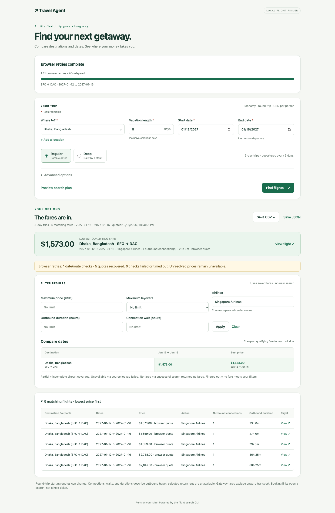

# Shareable announcement

Our local flight finder now has a deterministic **Retrieve missing prices (slower)** button for fares the regular search leaves unpriced. It opens disposable visible Chrome, checks Cheapest, filters airlines, and merges verified individual prices into the table, cheapest banner and CSV/JSON exports. It shows progress and ETA and preserves completed results when stopped.

The October 15, 2026 live app test recovered five Singapore Airlines outbound options for SFO–Dhaka, January 12–16, 2027, with a lowest observed USD economy round-trip starting quote of $1,573. Numeric network quotes matched final individual Cheapest rows and both request directions were restricted to Singapore. Prices change; these are search starting quotes, not held tickets or selected-return booking totals.

No login, personal Chrome profile, Node installation or agent deciding browser actions is required. Run the app or use the same CLI directly. Setup needs Python flight requirements and installed Google Chrome. The optional developer UI tests use Playwright to drive the local app.

Our recorded checks of fast-flights, fli and ordinary headless Playwright did not recover these Singapore prices. The native Chrome path did. We publish the method, limitations and repeatable tests; this is not a claim about every route or competing tool. Verified on Apple Silicon macOS; Intel hardware and native headless mode remain untested.

[Setup, app demo and CLI commands](https://github.com/sabcodes/Travel-Agent-Skills#recover-missing-singapore-prices-experimental).
