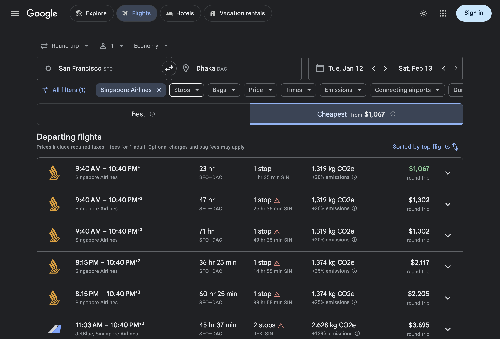

# Singapore pricing: native Chrome experiment

Checked October 14, 2026, on an Apple Silicon Mac. This is an isolated diagnostic prototype, not the app's browser retry implementation.

## Result

A deterministic script launching installed, visible Google Chrome in a new temporary profile recovered Singapore Airlines round-trip starting quotes. It searched SFO/DAC, opened **Cheapest**, expanded results, and then applied Singapore Airlines. The recorded shopping requests restrict **both** directions to `SQ`. Numeric network quotes match the final individual flight-row labels, with Cheapest selected, after a further 30-second check.

| Dates, inclusive | Singapore-only outbound options | Lowest observed USD starting quote |
|---|---:|---:|
| January 12-February 13, 2027 | 5 | $1,067 |
| January 12-16, 2027 (five days) | 5 | $1,573 |

The longer search passed in two independent fresh profiles and another fresh profile with `Runtime.enable` explicitly enabled. The five-day search passed once. These are observed Google search quotes, not purchased tickets or verified selected outbound/return booking totals. Intel hardware and headless native Chrome have not been tested with this method.



Screenshot captured October 14, 2026 for January 12-February 13, 2027. It contains observed public search quotes and no signed-in account information.

An earlier successful unfiltered run also found five priced Singapore outbound options. Its airline filter did not persist; it is not evidence of a Singapore restriction on both directions. The later filtered runs above establish that stronger condition.

## What the comparison establishes

- The old human HAR and unpriced automated HAR have identical decoded search JSON for filtered Best and expanded Cheapest, but different response pricing data. The decoder can read the recorded prices; this is not simply a parser omission.
- Both use HTTP/3 and the same Google frontend build. The human requests include `gl=US`; fresh tests with explicit US localization still lack prices. Localization alone is insufficient.
- Extra waiting and a persistent Playwright test profile did not recover prices.
- A native Chrome/CDP run with `navigator.webdriver=false` recovered prices. Sending `Runtime.enable` in that setup also recovered prices. CDP and that command alone therefore do not prevent this result.
- Adding only `--enable-automation` to the working native launch changed `navigator.webdriver` to true. That run returned no numeric Singapore quotes and a Google error after filtering. This supports an automation-environment difference, but one negative flag trial does not identify Google's internal classification or prove a specific anti-bot rule.
- Ordinary Playwright's Cheapest-first trials encountered Google errors, so those runs are failures, not successful empty searches. Omitting `--enable-automation` from Playwright did not itself clear its webdriver signal. Disabling the AutomationControlled feature cleared that signal but the trial failed before completing the search.

The working setup is an automated browser session: there was no manual login, personal profile reuse, copied cookie, or captured authentication replay. This disproves the blanket claim that every automated browser is unable to receive these prices. Google's exact reason for differentiating the other sessions remains unconfirmed.

The user reported seeing a Singapore price briefly disappear during a Playwright run. That particular transient price was not reproduced in the later DOM logs. A final-state verifier rejects a quote that appears earlier but disappears before completion.

## Reproduce

For this diagnostic only, install the normal flight and optional browser requirements described in the README, **Node.js 24+** (for its built-in WebSocket client), and Google Chrome in `/Applications`. The production flight app does not acquire a Node requirement.

Run from the experimental checkout. Every run creates and removes its own Chrome profile and closes its browser. It does not attach to an existing Chrome instance. Captures contain session data and belong in a private directory outside Git.

```bash
CAPTURE_DIR=$(mktemp -d /tmp/travel-singapore-probe.XXXXXX)
export CAPTURE_DIR
.venv/bin/python -c 'import os; from pathlib import Path; from evaluate_lightpanda import query_for; Path(os.environ["CAPTURE_DIR"], "url.txt").write_text(query_for("captured_singapore").url()+"&gl=US&hl=en-US")'
node probe_native_chrome.mjs "$CAPTURE_DIR/url.txt" "$CAPTURE_DIR/result" filter-after-cheapest
.venv/bin/python evaluate_lightpanda.py verify \
  --har "$CAPTURE_DIR/result/browser.har" \
  --report "$CAPTURE_DIR/result/report.json" \
  --output "$CAPTURE_DIR/result/verified.json"
```

For five inclusive days, generate the URL with `query_for("five_day_singapore")` and add `--case five_day_singapore` to the verifier. `--enable-automation` and `--enable-runtime` are optional native probe switches for the controlled comparisons; omit them for the baseline working setup.

The native probe reports flow completion separately from price verification. The verifier exits 0 only when both directions are filtered to SQ, the requested dates match, the flow completed, and numeric network prices match final Cheapest row labels. It exits 1 for missing prices, a failed flow, or mismatched constraints. A Cheapest header amount alone is insufficient. The original unpriced Playwright capture fails the same verifier.

`evaluate_lightpanda.py probe` exposes separate diagnostic switches for visible Chrome, a dedicated profile, HAR recording, region, waiting, and search order. Its regular defaults reproduce the unpriced Playwright path. `compare_flight_hars.py` exports public schedules, numeric fares, structural query differences, and header names without cookies or opaque context values.

## Lightpanda

The pinned build `1.1.0-nightly.10552+dd2cd5d7f` was tested separately. SHA-256: `35d4858813f1ff572550d1a8e55ea2886f313462e0ed93f95f9047792c66674a`.

One DOM-driven run reached filtered Cheapest with Singapore rows but no numeric price. Repeats stalled at Google's upgrade prompt or airline filtering. Its repeat HAR contains no shopping request and is not a comparable pricing capture. Lightpanda remains unsuitable for adoption from this evidence. Its screenshot output is a text dump, not a graphical Chrome render.

## Verification and integration boundary

The offline tests cover matching network/DOM quotes, currency, cabins, itinerary identity, duplicate frames, redacted output, both-leg airline filters, exact dates, provider failures, and withdrawn transient prices. Live captures independently establish the pricing result; unit tests do not establish live availability.

The prototype has not been merged into the application. A production adapter still needs configurable routes/dates, bounded waits and cancellation, missing-carrier targeting, progress/ETA, and the existing fare merge/ranking contract. It should preserve live search constraints and label starting quotes consistently with the normal provider. The separate retrieval button must merge verified fares and recompute filtered minima.

## References

- User-provided `Anti-Bot Detection And Evasion.pdf`: useful hypotheses, not evidence of Google's internal decision. The report itself notes that actual Chromium uses its native networking stack and that historical CDP serialization checks changed in V8.
- [Chrome headless architecture](https://developer.chrome.com/docs/automation-and-testing/headless).
- [Playwright browser launch and CDP options](https://playwright.dev/python/docs/api/class-browsertype).
- [SerpApi's description of progressive Google Flights data loading](https://serpapi.com/blog/how-to-scrape-google-flights/#get-results-that-match-your-browser): provider documentation, not proof of this session's cause.
- [Lightpanda architecture](https://lightpanda.io/docs/core-concepts/what-is-lightpanda).
